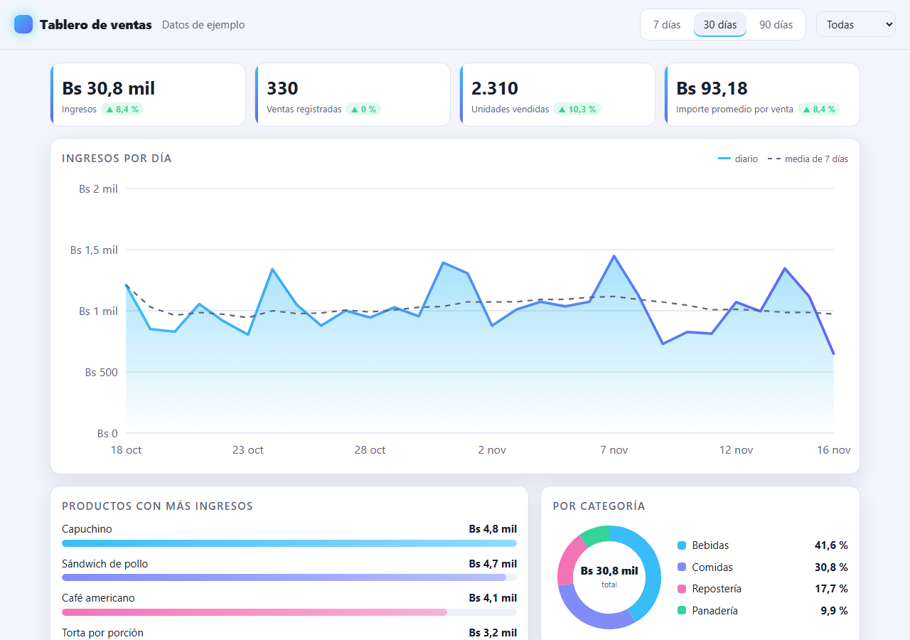

# Tablero de ventas — sales dashboard

**[Try the live demo](https://chacolla2001-art.github.io/tablero-ventas/)** · [Español](README.md)



A dashboard that turns a sales file into KPIs and charts: how much was sold, how it compares with the previous period, and which products and categories matter most. Charts are hand-built in SVG, with no libraries.

## Features
- **KPIs** for the period (7, 30 or 90 days): revenue, sales, units and average amount, each with its change versus the previous period.
- **Daily revenue** with a 7-day moving average and a hover indicator.
- **Top products by revenue** and **share by category** in a donut chart.
- **Category filter.**
- **Load your own CSV** (`fecha, producto, categoria, cantidad, precio`): it is read in the browser and never uploaded. Accepts commas or semicolons and reports bad rows without stopping the import.

## How it is built
Plain HTML, CSS and JavaScript — no frameworks, no dependencies.
- `src/logica.js`: CSV parsing (with quotes), filters, KPIs, moving average, grouping and chart geometry (scales, paths, arcs), all as pure functions.
- `src/graficos.js`: builds the SVG. Animations are CSS and are disabled when the system asks for reduced motion.
- `src/app.js`: filters, animated KPI counters and file loading.

```bash
npm test          # 13 tests: CSV, KPIs, series and geometry
npm start         # opens the dashboard at http://localhost:5182
```

Sample data is generated with a fixed-seed random generator. The interface and identifiers are in Spanish.

MIT License.
