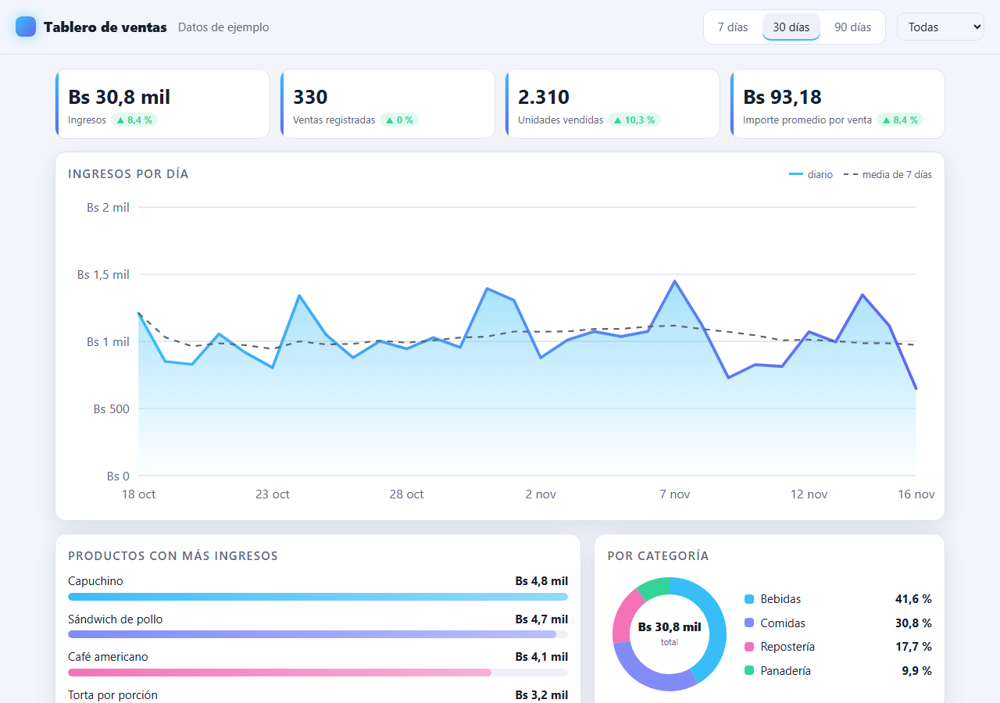

# Tablero de ventas

**[Probar la demo en vivo](https://chacolla2001-art.github.io/tablero-ventas/)** · [English](README.en.md)



Tablero que convierte un archivo de ventas en indicadores y gráficos: cuánto se vendió, cómo va frente al periodo anterior, qué productos y categorías pesan más. Los gráficos están hechos a mano en SVG, sin librerías.

## Qué hace
- **Indicadores** del periodo (7, 30 o 90 días): ingresos, ventas, unidades e importe promedio, cada uno con su variación frente al periodo anterior.
- **Ingresos por día** con media móvil de 7 días y un indicador al pasar el cursor.
- **Productos con más ingresos** y **reparto por categoría** en una dona.
- **Filtro por categoría.**
- **Carga tu propio CSV** (`fecha, producto, categoria, cantidad, precio`): se lee en el navegador y no se envía a ningún servidor. Acepta coma o punto y coma, y avisa qué filas tienen errores sin detener la carga.

## Cómo está hecho
HTML, CSS y JavaScript sin frameworks ni dependencias.
- `src/logica.js`: lectura de CSV (con comillas), filtros, indicadores, media móvil, agrupaciones y la geometría de los gráficos (escalas, rutas y arcos), todo como funciones puras.
- `src/graficos.js`: arma los SVG. Las animaciones son de CSS y se desactivan si el sistema pide menos movimiento.
- `src/app.js`: filtros, conteo animado de los indicadores y carga de archivos.

```bash
npm test          # 13 pruebas: CSV, indicadores, series y geometría
npm start         # abre el tablero en http://localhost:5182
```

Los datos de muestra se generan con un azar de semilla fija: son inventados y siempre iguales.

Licencia MIT.
